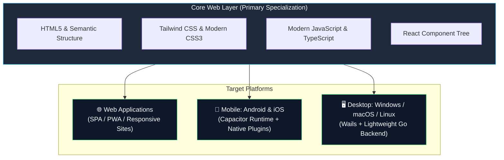

# 👋 Hey, I'm Robert Fernandez

**Frontend Specialist · Cross-Platform & Hybrid Mobile Developer · UI/UX Designer & Creator**

Building pixel-perfect, accessible web interfaces and shipping cross-platform apps to desktop and mobile.

  ✈️ <em>Explore a web-preview version of <strong>AviationPro</strong> in the aviation section on my <a href="https://robertfernandez.dev">live portfolio</a> (native desktop/mobile full version in repo).</em>

---

## 🧭 At a glance

| Category | Details |
|---|---|
| 💻 **Core Web (Specialization)** | **HTML5, CSS3, Modern JavaScript (ESNext).** Grounded in deep web fundamentals: semantic markup, responsive layouts, CSS architecture (Flexbox, Grid, custom animations), DOM manipulation, and WCAG accessibility standards. |
| ⚛️ **Modern Frontend Stack** | **React, TypeScript, Tailwind CSS.** Building robust, type-safe, component-driven client applications, state management, and modern design systems. |
| 📱 **Mobile & Hybrid Apps** | **Capacitor.** Packaging web apps into native Android & iOS binaries with device hardware integration, offline storage, and touch-first responsiveness. |
| 🖥️ **Cross-Platform Desktop** | **Wails.** Developing high-performance, lightweight native desktop applications using Go backend power paired with modern web frontends (HTML/CSS/JS/React). |
| 🎨 **Design & Visual Creative** | **UI/UX Design, Visual Arts & Content Creation.** Portfolios on **[Behance](https://www.behance.net/robertfern5088)** and **[DeviantArt](https://www.deviantart.com/rober321)**, ensuring frontend engineering is backed by aesthetic layout, color theory, and user-centric design. |
| 🛠️ **Build & Tooling** | Vite, Webpack, npm, pnpm, Git, Chrome DevTools, REST APIs, Android Studio. |
| 🎯 **Philosophy** | "One web codebase, everywhere." Clean architecture, zero-bloat interfaces, and accessible UX across desktop, tablet, and mobile. |

---

## 🏗️ Cross-Platform App Architecture

How core web technologies map into multi-platform deliverables:

---

## 🚀 Featured Projects

Grouped by platform and specialization.

### 📱 Cross-Platform & Mobile (Wails & Capacitor)

| Project | What it does | Stack | Links |
|---|---|---|---|
| **[Paperworks](https://github.com/robfernan/Paperworks)** | Full-featured business automation suite and professional document generator. Packages a modern, responsive web frontend into native cross-platform desktop (Wails + Go) and mobile (Capacitor for Android) applications. | `Wails` `Capacitor` `Go` `React` `TypeScript` `Tailwind CSS` | [View Repo](https://github.com/robfernan/Paperworks) |
| **[AviationPro](https://github.com/robfernan/AviationPro)** | Aviation-focused web tool suite / platform featuring interactive aeronautical utilities, data rendering, and a responsive interface tailored for flight tracking and aviation workflows. | `Wails` `Capacitor` `Go` `React` `TypeScript` `Tailwind CSS` `HTML5/CSS3` | [View Repo](https://github.com/robfernan/AviationPro) · [Web Preview](https://robertfernandez.dev) |

  
📸 <strong>Preview Platform Views (AviationPro & Paperworks)</strong>

   
  <table>
    <tr>
      <th align="center">AviationPro Desktop (Wails)</th>
      <th align="center">AviationPro Mobile (Capacitor)</th>
      <th align="center">PaperworksPro Suite</th>
    </tr>
    <tr>
      <td align="center">
        
      </td>
      <td align="center">
        
      </td>
      <td align="center">
        
      </td>
    </tr>
  </table>

### 🌐 Core Web & Frontend

| Project | What it does | Stack | Links |
|---|---|---|---|
| **[React Portfolio](https://github.com/robfernan/react-portfolio)** | My official personal portfolio website. Built with React, TypeScript, and modern responsive CSS, featuring interactive component states, project showcases, and clean UI architecture. | `React` `TypeScript` `Tailwind CSS` `Vite` | [View Repo](https://github.com/robfernan/react-portfolio) · [Live Site](https://robertfernandez.dev) |

### 🕹️ Creative & Modern Recreations (Hobby)

Modern reimagining of classic interfaces and media players, exploring UI ergonomics, desktop launchers, and retro-tech nostalgia:

| Project | What it does | Stack | Links |
|---|---|---|---|
| **[Love2D_XboxLauncher](https://github.com/robfernan/Love2D_XboxLauncher)** | Xbox-inspired desktop launcher featuring a custom frameless draggable window, gamepad-ready navigation, and authentic retro blade UI transitions. | `Lua` `Love2D (LÖVE)` `Desktop UI` | [View Repo](https://github.com/robfernan/Love2D_XboxLauncher) |
| **[XMB Menu Launcher](https://github.com/robfernan/XMB-Menu-Launcher)** | Web-based recreation of the PlayStation 3 XrossMediaBar (XMB) interface. A browser-based menu launcher for links, custom themes, and sound effects with zero build step. | `Vanilla HTML5` `CSS3` `JavaScript` | [View Repo](https://github.com/robfernan/XMB-Menu-Launcher) |
| **[PSP Digital Comics](https://github.com/robfernan/psp-comics-reborn)** | Faithful cross-platform recreation of the iconic PSP comic reader for `.cbz` archives, packaging desktop and mobile versions. | `Wails` `Capacitor` `React` `TypeScript` `Tailwind CSS` | [View Repo](https://github.com/robfernan/psp-comics-reborn) |
| **[sony2002recreation](https://github.com/robfernan/sony2002recreation)** | Authentic modern recreation of the early-2000s Sony promotional website experience and retro web design language. | `HTML5` `CSS3` `JavaScript` | [View Repo](https://github.com/robfernan/sony2002recreation) |

  
📸 <strong>Preview Recreations (PSP Comics & Xbox Launcher)</strong>

   
  <table>
    <tr>
      <th align="center">PSP Digital Comics Reader</th>
      <th align="center">Love2D Xbox Blades Launcher</th>
    </tr>
    <tr>
      <td align="center">
        
      </td>
      <td align="center">
        
      </td>
      <td align="center">
        
      </td>
    </tr>
  </table>

---

## 🛠️ Complete Tech Stack

  <strong>Core Frontend</strong> 
  
  
  
  
  
  
  

  <strong>Cross-Platform & Runtimes</strong> 
  
  
  
  
  
  
  

  <strong>Design & Creative Direction</strong> 
  
  
  
  
  

---

## 📊 GitHub Stats

  
  

  

---

## 🏆 Milestones & Highlights

- 💼 **Production Client Software:** Shipped document generation and invoice tooling utilized in real commercial business operations.
- ✈️ **Real-World Aviation Utilities:** Engineered pilot tools (AviationPro) tested and utilized during live pilot flight training (120+ flight hours).
- 🎨 **Certified Visual Designer:** Adobe Certified Professional in Visual Design, Illustration & Web Authoring (Photoshop, Illustrator, Dreamweaver, Animate).
- 🎮 **Shipped Independent Work:** Published original game titles (Hopeless Catch) and authored open-source console homebrew documentation (PS1/PS2/PSP).

---

## 🤝 Let's Connect & Build

I'm always open to discussing frontend engineering roles, cross-platform app projects, creative collaborations, or open-source work.

- **GitHub:** [@robfernan](https://github.com/robfernan)
- **LinkedIn:** [linkedin.com/in/robfernan](https://linkedin.com/in/robfernan)
- **Portfolio:** [robertfernandez.dev](https://robertfernandez.dev)
- **Email:** [rf80678@gmail.com](mailto:rf80678@gmail.com)
- **Creative & Content:** [YouTube](https://www.youtube.com/@MungDaal321) · [Twitch](https://www.twitch.tv/mungdaal321) · [WordPress Blog](https://robertfernandez1.wordpress.com) · [Behance](https://www.behance.net/robertfern5088) · [DeviantArt](https://www.deviantart.com/rober321)

---

⚡ Built with HTML5, CSS3, JavaScript, TypeScript, React, Tailwind, Wails & Capacitor

