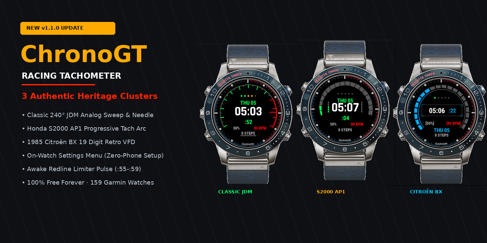
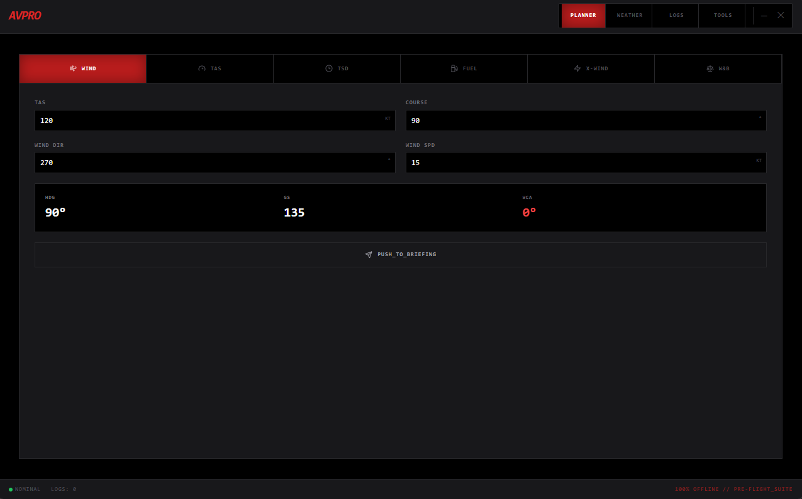

# Hey, I'm Robert Fernandez

**Full-Stack Web Developer · Cross-Platform Engineer · Digital Artist · Student Pilot**

B.A. Computer Science Concentration, FAU · Shipping production business software, multi-surface apps, and a published Garmin Connect IQ watch face · Based in West Palm Beach, FL · Available for roles & projects

Aviation tools & flight notes live on the <a href="https://robertfernandez.dev/aviation">portfolio aviation desk</a>.

---

## Now building

- **[ChronoGT](https://github.com/robfernan/ChronoGT)** — motorsport tachometer watch face on the [Garmin Connect IQ Store](https://apps.garmin.com/en-US/apps/a213d2da-0d13-4e02-ae58-3525fb89306a) (159 watch models; procedural vectors; tight RAM budget)
- **[AviationPro](https://github.com/robfernan/AviationPro)** — browser EFB / flight utilities (NavLog, CX-3 style calcs, weather, W&B) · [Live](https://robfernan.github.io/AviationPro/) · [Portfolio](https://robertfernandez.dev/aviation)
- **[pico-hil-autopilot](https://github.com/robfernan/pico-hil-autopilot)** — RP2350 hardware-in-the-loop flight-dynamics rig + SDL2 ground station (newest push)
- **[Paperworks](https://github.com/robfernan/Paperworks)** — document / business suite · [Live web](https://robfernan.github.io/Paperworks/) · native desktop & mobile in progress

---

## Proof

| | |
|---|---|
| **Production** | Software Developer & UI/UX Designer at [Florida Window & Door Maintenance, Inc.](https://floridawindowndoormaintenance.com) (Jan 2021 – Present) — commercial web, proposals, invoicing |
| **Wearables** | [ChronoGT](https://apps.garmin.com/en-US/apps/a213d2da-0d13-4e02-ae58-3525fb89306a) v1.1.0 on the official Garmin store — three heritage racing clusters, on-watch settings menu, 159 certified models, live and free on Connect IQ (100+ downloads) · [demo](https://youtube.com/shorts/R3h-WX0FZ2w) |
| **Hardware** | Custom RP2350 (Raspberry Pi Pico 2) hardware-in-the-loop flight-dynamics rig + SDL2 ground station ([pico-hil-autopilot](https://github.com/robfernan/pico-hil-autopilot)) |
| **Aviation** | FAA Student Pilot · **129.2** logged hours as of 2026-10-14 (see [/aviation](https://robertfernandez.dev/aviation) flight log preview) |
| **School** | B.A. CS Concentration (Minor History), FAU · Dec 2022 · A.A. CS · May 2021 |
| **Design** | 4× Adobe Certified Professional (Photoshop, Illustrator, Dreamweaver, Animate) |

  
   
  ChronoGT v1.1.0 Multi-Cluster — Classic JDM, Honda S2000 AP1, and 1985 Citroën BX 19 Digit on Garmin Connect IQ

---

## How I ship

Web-first React/TypeScript (Vite, Tailwind), then package to the surface that needs it:

- **Web** — responsive, WCAG-minded UI
- **Desktop** — Wails (Go + React) where a native shell helps
- **Mobile** — Capacitor / Flutter when the product needs it
- **Wearables & embedded** — Monkey C / Connect IQ, C/C++ & SDL where hardware matters

### How I think about constraints

- **Aviation discipline in software:** Flight training enforces methodical checklists and rigorous failure-mode analysis. I don't ship a path I haven't walked through as a failure case.
- **Embedded & resource boundaries:** Developing ChronoGT for memory-constrained Garmin MIP displays required pure 2D vector mathematics and deterministic rendering without heavy bitmap allocations.
- **Typed contracts across surfaces:** Web-first frontends (React/TypeScript) stay resilient when packaging to Wails or Capacitor because data schemas and boundary IPC calls are strictly typed and audited upfront.

### Competencies

| Area | Stack |
|---|---|
| Full-stack & systems | TypeScript, React, Go, Dart/Flutter, C/C++, Python |
| Cross-platform | Wails, Capacitor, Flutter, Connect IQ |
| Design | Adobe suite, UI/UX, pre-press / brand work |
| Hardware & retro | Garmin, Love2D/Lua, PSP/PS1 homebrew (C, SDL2, MIPS) |

---

## Selected work

### Wearables

| Project | One-liner | Links |
|---|---|---|
| **[ChronoGT](https://github.com/robfernan/ChronoGT)** | Motorsport watch face with three heritage racing clusters (Classic JDM Analog, S2000 AP1, BX 19 Digit); procedural 2D vectors; published free on Garmin | [Repo](https://github.com/robfernan/ChronoGT) · [Store](https://apps.garmin.com/en-US/apps/a213d2da-0d13-4e02-ae58-3525fb89306a) · [YouTube](https://youtube.com/shorts/R3h-WX0FZ2w) |

### Cross-platform apps

| Project | One-liner | Links |
|---|---|---|
| **[AviationPro](https://github.com/robfernan/AviationPro)** | Multi-tab EFB-style utilities tested against real training flights | [Repo](https://github.com/robfernan/AviationPro) · [Live](https://robfernan.github.io/AviationPro/) · [Site](https://robertfernandez.dev/aviation) |
| **[Paperworks](https://github.com/robfernan/Paperworks)** | Professional document / business automation suite (web live; native packaging next) | [Repo](https://github.com/robfernan/Paperworks) · [Live](https://robfernan.github.io/Paperworks/) |

  
<strong>Previews — AviationPro & Paperworks</strong>

   
  <table>
    <tr>
      <th align="center">AviationPro</th>
      <th align="center">AviationPro mobile</th>
      <th align="center">Paperworks</th>
    </tr>
    <tr>
      <td align="center"></td>
      <td align="center"></td>
      <td align="center"></td>
    </tr>
  </table>

### Aviation + embedded

| Project | One-liner | Links |
|---|---|---|
| **[pico-hil-autopilot](https://github.com/robfernan/pico-hil-autopilot)** | Hardware-in-the-loop flight dynamics on RP2350 with an SDL2 ground station | [Repo](https://github.com/robfernan/pico-hil-autopilot) |

### Retro UI & hardware

| Project | One-liner | Links |
|---|---|---|
| **[psp-comics-reborn](https://github.com/robfernan/psp-comics-reborn)** | Modern recreation of the PSP Digital Comics reader | [Repo](https://github.com/robfernan/psp-comics-reborn) |
| **[PSP-Programming](https://github.com/robfernan/PSP-Programming)** | C / SDL2 homebrew notes and modules on real PSP hardware | [Repo](https://github.com/robfernan/PSP-Programming) |

---

## Activity

  

<!-- Shared github-readme-stats cards omitted: vercel.app often 503s for visitors. Re-add only if self-hosted. -->

---

## Elsewhere

Open to engineering roles, cross-platform contracts, and design collaborations.

- **Portfolio:** [robertfernandez.dev](https://robertfernandez.dev)
- **LinkedIn:** [linkedin.com/in/robfernan](https://linkedin.com/in/robfernan)
- **GitHub:** [@robfernan](https://github.com/robfernan)
- **Streaming / maker:** [YouTube](https://www.youtube.com/@MungDaal321) · [Twitch](https://www.twitch.tv/mungdaal321) · [itch.io](https://mungdaal321.itch.io)
- **Art:** [ArtStation](https://robertfernandez7.artstation.com) · [Behance](https://www.behance.net/robertfern5088)

---

Craft · systems · cockpit discipline — web, desktop, mobile & wearables

